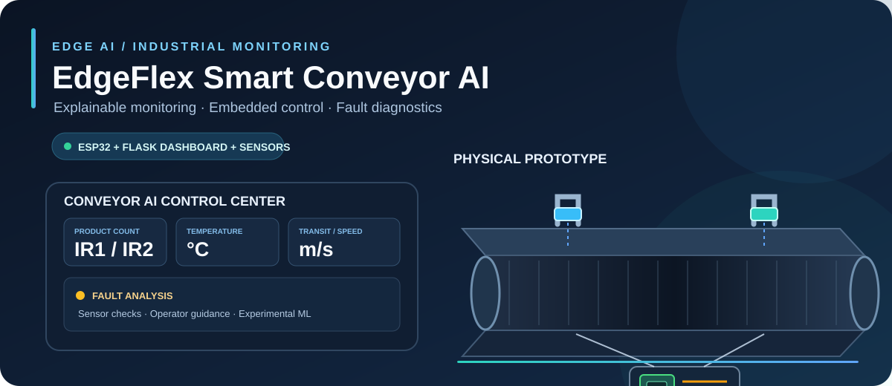
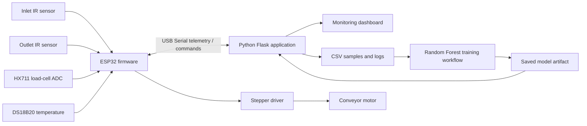

<div align="center">



# EdgeFlex Smart Conveyor AI
### Explainable Monitoring • Embedded Control • Fault Diagnostics

**A physical conveyor prototype with ESP32 telemetry, sensor-based interlocks, a Flask dashboard, and an experimental Random Forest workflow.**

[](https://www.espressif.com/)
[](https://www.python.org/)
[](https://github.com/Palanirajmvlsi/EdgeFlex-Smart-Conveyor-AI)
[](https://github.com/Palanirajmvlsi/EdgeFlex-Smart-Conveyor-AI)

[**System architecture**](#-system-architecture) · [**Quick start**](#-quick-start) · [**Safety and validation**](#-safety-and-validation)

</div>

---

## Overview

EdgeFlex Smart Conveyor AI is a physical conveyor-belt prototype built to explore monitoring and fault diagnosis in small industrial automation systems. An ESP32 collects sensor readings and conveyor counts, applies embedded operating checks, and streams telemetry to a Python dashboard over serial. The dashboard displays status, observations, recommended operator checks, and data-collection/model controls.

The repository combines prototype firmware, the Python application, datasets/logs, and saved model artifacts. It is a work in progress: use the instructions and limitations below to reproduce and evaluate the implementation rather than treating this as a certified industrial safety controller.

## Highlights

| Area | Current implementation |
|---|---|
| Sensor telemetry | HX711 raw load-cell readings, DS18B20 temperature, and two IR sensors |
| Product tracking | Inlet/outlet counts, completed-product count, transit timing, and estimated speed |
| Embedded control | ESP32 stepper-driver signals and command handling for stop/restart/count reset/tare |
| Fault checks | Sensor validity, overload, temperature, transit timeout, and transit timing checks |
| Operator dashboard | Flask-based monitoring and motor-control interface |
| Data workflow | CSV sample collection, downloadable data, and model training/prediction controls |
| Persistence | ESP32 Preferences storage for counts |

> **Model status:** The repository includes Random Forest model/data artifacts and dashboard model controls. Treat predictions as experimental until the labels, held-out evaluation, class distribution, and measured metrics are documented. The presence of a `.joblib` file alone does not establish model accuracy.

## 🖥️ Dashboard and Prototype

The Flask dashboard is designed to display live counts, HX711 raw value/load change, temperature, transit time, speed estimate, motor state, fault diagnosis, sample collection, and model actions. The vector banner above is a visual overview of the system; it is not a live dashboard screenshot or a measured test result.

Actual dashboard screenshots and photographs of the physical conveyor can be placed in `media/` as the project's image evidence is committed. Use genuine prototype photos and label screenshot values as snapshots rather than benchmark results.

## 🧠 System Architecture



## 🔩 Hardware and Firmware

The checked-in firmware file `conveyor1_esp32/conveyor1_esp32.ino` currently defines this GPIO map:

| Signal | ESP32 GPIO | Purpose |
|---|---:|---|
| HX711 DOUT | 19 | Raw load-cell data |
| HX711 SCK | 18 | HX711 clock |
| DS18B20 DATA | 4 | Temperature |
| IR1 OUT | 32 | Inlet object detection |
| IR2 OUT | 33 | Outlet object detection |
| Stepper PUL/STEP | 25 | Driver pulse |
| Stepper DIR | 26 | Direction |
| Stepper ENA | 27 | Driver enable |

Firmware libraries include HX711, OneWire, DallasTemperature, and ESP32 Preferences. The exact driver interface and enable polarity depend on the driver variant and wiring; inspect the physical build before powering the motor.

## 🧰 Quick Start

### 1. Clone the repository

```bash
git clone https://github.com/Palanirajmvlsi/EdgeFlex-Smart-Conveyor-AI.git
cd EdgeFlex-Smart-Conveyor-AI
```

### 2. Create a Python environment

On Windows:

```powershell
py -3.11 -m venv .venv
.\.venv\Scripts\activate
python -m pip install --upgrade pip
python -m pip install flask pyserial scikit-learn joblib pandas openpyxl
```

Use a Python version compatible with all installed packages. If installation fails, capture the full error rather than mixing packages from different interpreter versions or architectures.

### 3. Prepare the ESP32

1. Open `conveyor1_esp32/conveyor1_esp32.ino` in Arduino IDE.
2. Install the required HX711, OneWire, and DallasTemperature libraries.
3. Select the ESP32 board package and correct serial port.
4. Verify wiring, driver polarity, and safety interlocks with motor power isolated.
5. Upload the sketch.

### 4. Run the dashboard

Inspect the application's supported command-line options first:

```powershell
python app.py --help
```

Then start it using the port and baud settings supported by the application. Select the COM port shown in Windows Device Manager. Do not open Arduino Serial Monitor on the same port while Python is connected.

## 📁 Repository Contents

| Path | Purpose |
|---|---|
| `app.py` | Flask dashboard, serial telemetry processing, diagnostics, and model controls |
| `conveyor1_esp32/conveyor1_esp32.ino` | ESP32 sensor reading, counts, motor control, and telemetry |
| `conveyor_ai.py` | Python serial/data processing utility |
| `conveyor_data.csv` | Collected training/sample data |
| `conveyor_history.csv` | Historical application data |
| `conveyor_log.csv` | Logged records |
| `conveyor_training_data.csv` | Training dataset |
| `conveyor_rf.joblib`, `conveyor_rf_model.joblib` | Saved model artifacts; inspect the application configuration to confirm the artifact currently loaded |

Generated CSV logs and locally trained model files may change during use. Keep passwords, private/operator-sensitive information, and secrets out of public commits.

## 🧪 Validation Checklist

- [ ] Verify sensor readings against known inputs and inspect disconnect/failure behavior.
- [ ] Test inlet/outlet counting with single objects and closely spaced objects.
- [ ] Compare measured transit time and speed with an independent reference.
- [ ] Verify stop/restart and fault-latch behavior with motor power safely isolated first.
- [ ] Test temperature, load-threshold, and timeout conditions.
- [ ] Evaluate the classifier on held-out labelled records; publish class distribution, confusion matrix, precision/recall, and test procedure.
- [ ] Record test conditions, firmware revision, environment, and limitations.

## ⚠️ Safety and Validation

This is an experimental student prototype, not a certified safety system. Keep a physical emergency stop and appropriate electrical/mechanical protection in place. Test with motor power disconnected wherever possible. Confirm sensor voltage compatibility, grounding, driver wiring, mechanical guarding, and threshold settings before operation.

The HX711 output is a raw count unless calibrated; it is not weight in kilograms. Transit-derived speed is an estimate based on configured sensor spacing and timing. Dashboard warnings and model predictions are advisory and must not replace validated safety interlocks or supervised operator procedures.

## 🔭 Future Work

- Add real dashboard screenshots and labelled photographs of the hardware to `media/`.
- Document the verified wiring and setup with reproducible procedures.
- Add automated tests for serial parsing, fault logic, and dashboard routes.
- Publish transparent model evaluation and failure-case reports.
- Measure response latency and resource use under stated test conditions.
- Improve multi-object tracking for close or overlapping inlet/outlet events.

## License

No license has been verified for this repository. Until a license file is added by the project owner, do not assume the code is available for reuse or redistribution.

<div align="center">

**Built to make small conveyor systems easier to observe, diagnose, and improve.**

</div>
