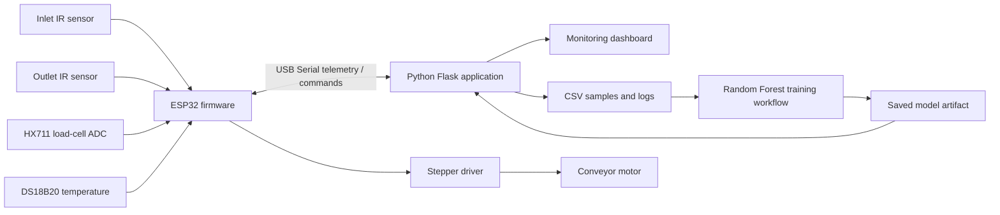

<div align="center">


# EdgeFlex Smart Conveyor AI
### Explainable Monitoring • Embedded Control • Fault Diagnostics

**A physical conveyor prototype with ESP32 telemetry, sensor-based interlocks, a Flask dashboard, and an experimental Random Forest workflow.**

[](https://www.espressif.com/)
[](https://www.python.org/)
[](https://github.com/Palanirajmvlsi/EdgeFlex-Smart-Conveyor-AI)
[](https://github.com/Palanirajmvlsi/EdgeFlex-Smart-Conveyor-AI)

[**Explore the hardware gallery**](#-prototype-gallery) · [**Setup guide**](#-quick-start) · [**Safety notes**](#-safety-and-validation)

</div>

---

## Overview

EdgeFlex Smart Conveyor AI is a physical conveyor-belt prototype built to explore monitoring and fault diagnosis in small industrial automation systems. An ESP32 collects sensor readings and conveyor counts, applies embedded operating checks, and streams telemetry to a Python dashboard over serial. The dashboard displays status, observations, recommended operator checks, and data-collection/model controls.

The repository combines the prototype firmware, Python application, datasets/logs, and saved model artifacts. It is a work in progress: use the instructions and limitations below to reproduce and evaluate the implementation rather than treating this as a certified industrial safety controller.

## Highlights

| Area | Current implementation |
|---|---|
| Sensor telemetry | HX711 raw load-cell readings, DS18B20 temperature, and two IR sensors |
| Product tracking | Inlet/outlet counts, completed-product count, transit timing, and estimated speed |
| Embedded control | ESP32 stepper-driver signals and command handling for stop/restart/count reset/tare |
| Fault checks | Sensor validity, overload, temperature, transit timeout, and transit timing checks |
| Operator dashboard | Flask-based live monitoring and motor-control interface |
| Data workflow | CSV sample collection, downloadable data, model training/prediction controls |
| Persistence | ESP32 Preferences storage for counts |

> **Model status:** The repository includes Random Forest model/data artifacts and model controls in the dashboard. Treat predictions as experimental until the dataset, labels, held-out evaluation, and measured metrics are documented. Do not infer model accuracy from the presence of a `.joblib` file.

## 🖥️ Dashboard Preview

The dashboard is designed to display live counts, HX711 raw value/load change, temperature, transit time, speed estimate, motor state, observation/fault diagnosis, sample collection, and model actions.

Place the supplied screenshot at `media/dashboard-overview.png` to show it here:

<div align="center">
  
  <sub>Dashboard screenshot from the current prototype. Displayed values are a snapshot, not a performance benchmark.</sub>
</div>

## 📷 Prototype Gallery

Add the selected photos to `media/` using these filenames to enable the gallery below.

<div align="center">
  <table>
    <tr>
      <td align="center" width="50%"><br/><b>Conveyor assembly</b></td>
      <td align="center" width="50%"><br/><b>Controller and motor driver</b></td>
    </tr>
    <tr>
      <td align="center" width="50%"><br/><b>Inlet detection sensor</b></td>
      <td align="center" width="50%"><br/><b>Outlet detection sensor</b></td>
    </tr>
  </table>
</div>

## 🧠 System Architecture



## 🔩 Hardware and Firmware

The checked-in firmware file `conveyor1_esp32/conveyor1_esp32.ino` currently defines this GPIO map:

| Signal | ESP32 GPIO | Purpose |
|---|---:|---|
| HX711 DOUT | 19 | Raw load-cell data |
| HX711 SCK | 18 | HX711 clock |
| DS18B20 DATA | 4 | Temperature |
| IR1 OUT | 32 | Inlet object detection |
| IR2 OUT | 33 | Outlet object detection |
| Stepper PUL/STEP | 25 | Driver pulse |
| Stepper DIR | 26 | Direction |
| Stepper ENA | 27 | Driver enable |

Firmware libraries include HX711, OneWire, DallasTemperature, and ESP32 Preferences. The exact driver interface and enable polarity depend on the hardware variant and wiring; inspect the physical build before powering the motor.

## 🧰 Quick Start

### 1. Clone the repository

```bash
git clone https://github.com/Palanirajmvlsi/EdgeFlex-Smart-Conveyor-AI.git
cd EdgeFlex-Smart-Conveyor-AI
```

### 2. Create a Python environment

On Windows:

```powershell
py -3.11 -m venv .venv
.\.venv\Scripts\activate
python -m pip install --upgrade pip
```

Install the dependencies used by the application:

```powershell
python -m pip install flask pyserial scikit-learn joblib pandas openpyxl
```

Use a Python version supported by all installed packages. If installation fails, share the full error rather than mixing packages from a different interpreter/architecture.

### 3. Prepare the ESP32

1. Open `conveyor1_esp32/conveyor1_esp32.ino` in Arduino IDE.
2. Install the required libraries listed above.
3. Select the ESP32 board package and the correct serial port.
4. Verify wiring and motor-driver polarity with motor power isolated.
5. Upload the sketch.

### 4. Run the dashboard

Inspect the CLI options supported by your local application first:

```powershell
python app.py --help
```

Then run the application using its documented port and baud options. Select the COM port shown in Windows Device Manager. Do not open Arduino Serial Monitor on the same port while the Python application is connected.

## 📁 Repository Contents

| Path | Purpose |
|---|---|
| `app.py` | Flask dashboard, serial telemetry processing, diagnostics, and model controls |
| `conveyor1_esp32/conveyor1_esp32.ino` | ESP32 firmware for sensor reading, counts, motor control, and telemetry |
| `conveyor_ai.py` | Python serial/data processing utility |
| `conveyor_data.csv` | Collected training/sample data |
| `conveyor_history.csv` | Historical application data |
| `conveyor_log.csv` | Logged records |
| `conveyor_training_data.csv` | Training dataset |
| `conveyor_rf.joblib`, `conveyor_rf_model.joblib` | Saved model artifacts; confirm which artifact the app currently loads |

Generated CSV logs and locally trained model files may change during use. Keep any private/operator-sensitive data out of public commits.

## 🧪 Validation Checklist

Before interpreting the project as a reliable control system, document repeatable tests:

- [ ] Verify every sensor against known inputs and inspect disconnect/failure behavior.
- [ ] Check inlet/outlet counting with single objects and closely spaced objects.
- [ ] Measure transit time and speed against an independent reference.
- [ ] Verify stop/restart and fault-latch behavior with the motor power stage safely isolated first.
- [ ] Test high-temperature, load-threshold, and timeout conditions.
- [ ] Evaluate the classifier on held-out, labelled records; publish the class distribution, confusion matrix, precision/recall, and test procedure.
- [ ] Record actual test conditions, firmware revision, environment, and limitations.

## ⚠️ Safety and Validation

This is an experimental student prototype, not a certified safety system. Keep a physical emergency stop and suitable electrical/mechanical protection in place. Test with the motor power disconnected where possible. Confirm sensor voltage compatibility, grounding, driver wiring, mechanical guarding, and threshold settings before operation.

The HX711 measurement is a raw count unless calibrated; it is not a weight in kilograms. Transit-derived speed is only an estimate based on the configured sensor spacing and timing. Dashboard warnings and model predictions are advisory and must not replace validated interlocks or supervised operator procedures.

## 🔭 Future Work

- Add reproducible hardware/software setup and wiring photographs.
- Separate firmware, dashboard, documentation, and sample media into clearer folders.
- Add automated tests for serial parsing, fault logic, and dashboard routes.
- Add timestamped test procedures and transparent model evaluation reports.
- Record resource use and response latency under defined conditions.
- Evaluate robust multi-object tracking for overlapping inlet/outlet events.

## License

No license has been verified for this repository. Unless a license file is added by the project owner, do not assume the code is available for reuse or redistribution.

<div align="center">

**Built to make small conveyor systems easier to observe, diagnose, and improve.**

</div>
